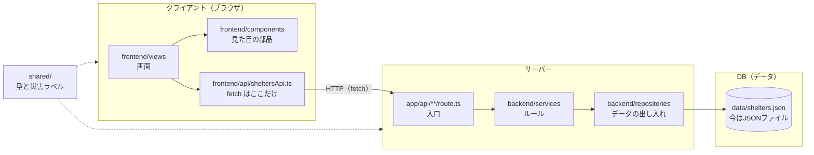
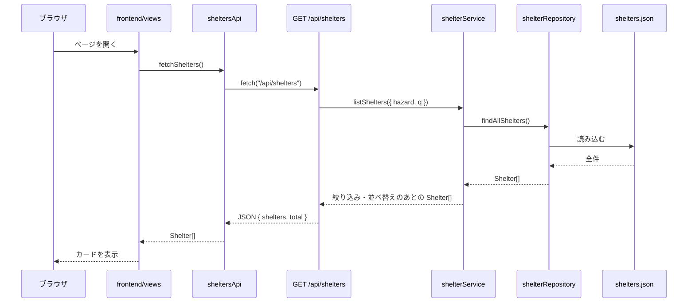

# CLAUDE.md（指定緊急避難場所の一覧・学習用）

## このアプリは何か

指定緊急避難場所の一覧を見せる、学習用の小さなアプリです。Next.js 16.4.6 で作っています。
データは **架空のサンプルデータ**（自治体標準オープンデータセットの形）です。実在の施設ではありません。

このアプリでいちばん大事なのは、**フロントエンドとバックエンドの役割を分けること**です。
機能を足すときも、この分け方を崩さないでください。

## 3つの層はどこにあるか

| 層 | フォルダ | 持つもの | 持たないもの |
|---|---|---|---|
| クライアント | `frontend/`、`app/page.tsx`、`app/shelters/` | 画面、見た目、fetch の呼び出し（`frontend/api`） | データの絞り込みルール、`data/` の読み込み |
| サーバー | `app/api/`、`backend/services/`、`backend/repositories/` | リクエストの読み取り、絞り込み・並べ替え・見つからない判断、データの出し入れ（repository） | 画面の文言、HTML、JSX |
| DB（データ） | `data/` | データそのもの。今は JSON ファイル。本物のアプリでは DB がここに来る | コード、ルール |
| 共通 | `shared/` | 型（`Shelter` など）、災害のキーとラベル | 上の層のコード |

## 1回のリクエストの流れ

## 守るルール（Claude はこれに従う）

向きは **frontend → HTTP → app/api → backend/services → backend/repositories → data** の一方向です。逆向きの呼び出しは作りません。

1. `frontend/**` から `backend/**` と `data/**` を import しない。
2. `backend/**` から `frontend/**` を import しない。
3. `shared/**` は frontend、backend、data を import しない。どちらの層からも import してよい。
4. `app/api/**` が import してよいのは `backend/**` と `shared/**` だけ。
5. `app/page.tsx` と `app/shelters/**` が import してよいのは `frontend/**` と `shared/**` だけ。
6. `backend/**` のファイルは、先頭に `import "server-only";` を書く。
7. `data/shelters.json` を読むのは `backend/repositories/shelterRepository.ts` だけ。
8. APIのURLを知り、`fetch` を呼ぶのは `frontend/api/sheltersApi.ts` だけ。

守らせる仕組みは2つあります。

- ESLint の `no-restricted-imports`（`eslint.config.mjs`）。境界を破ると `npm run lint` が失敗します。
- `server-only`。backend のコードをブラウザ側が import すると、ビルドが失敗します。

## 機能を足すときの手順

各手順は、上から順に触ります。

**(a) 災害の種類で絞り込むボタン（フロントだけ）**
バックエンドはもう `hazard` に対応しています。
1. `frontend/api/sheltersApi.ts`：`fetchShelters({ hazard })` を使う（すでに引数はあります）
2. `frontend/components/`：ボタンの部品を作る（`HAZARD_LABELS` を使う）
3. `frontend/views/ShelterListView.tsx`：選んだ種類を state に持ち、変わったら再取得する

**(b) 検索欄（フロントだけ）**
バックエンドはもう `q` に対応しています。(a) と同じ形で、`q` を渡します。

**(c) 新しい項目を表示する**
1. `shared/types.ts`：`Shelter` に項目を足す
2. `data/shelters.json`：値を足す（必要なら `scripts/import-shelters-csv.mjs` も）
3. `backend/repositories/shelterRepository.ts`：必要なら読み方を直す
4. `backend/services/shelterService.ts`：ルールが要るときだけ
5. `frontend/components/`：表示を足す

**(d) データをDBに替える**
触るのは `backend/repositories/` だけです。関数の名前と返す型は変えません。service、route、frontend は触りません。
注意：Vercel では、`data/` のファイルや SQLite に書き込んでも残りません（サーバーが立ち上がっては消える作りのためです）。書き込むなら Neon・Supabase（PostgreSQL）や Turso のような外のDBを使います。読むだけなら、今の JSON のままでかまいません。

**(e) 地図を表示する**
フロントの部品（`frontend/components/`）だけを足します。座標は `Shelter` の `lat`、`lng` にあります。

**(f) 新しいAPIを足す**
1. `shared/types.ts`：返す形（response の型）を決める
2. `backend/repositories/`：新しいデータが要るときだけ関数を足す
3. `backend/services/`：ルールを書く
4. `app/api/<名前>/route.ts`：入口を作る（読み取り、service を呼ぶ、JSON で返す）
5. `frontend/api/sheltersApi.ts`：呼び出す関数を足す
6. `frontend/views` か `frontend/components`：画面に出す

**(g) ページを足す**
1. `app/<名前>/page.tsx`：入口を作る。中身は `frontend/views` の画面を呼ぶだけにする
2. `frontend/views/`：画面を作る（データは `sheltersApi.ts` から取る）

このアプリは `next.config.ts` で `cacheComponents` が有効です。入口で `params` を `await` するときは、その部分を `Suspense` で包みます。包まないと `npm run build` が失敗します。書き方は `app/shelters/[id]/page.tsx` を見てください。

## やってはいけないこと

- コンポーネントや view の中で直接 `fetch` する（`sheltersApi.ts` に書く）
- フロントから `data/` を読む、`backend/` を import する
- 絞り込みや並べ替えのルールをフロントに書く（`backend/services` に書く）
- バックエンドに画面の文言や HTML を入れる（返すのはデータと、エラーのメッセージだけ）
- ESLint のルールを弱める、`eslint-disable` で境界チェックを消す
- `npm run check` を通さずに終わる

## コマンド

| コマンド | 何をするか |
|---|---|
| `npm run dev` | 開発用サーバーを起動（http://localhost:3000） |
| `npm run lint` | ESLint。層の境界もここで調べる |
| `npm run check` | lint、型の準備（`next typegen`）、型チェック、ビルドをまとめて実行 |

**変更のあとは必ず `npm run check` を通す。**
